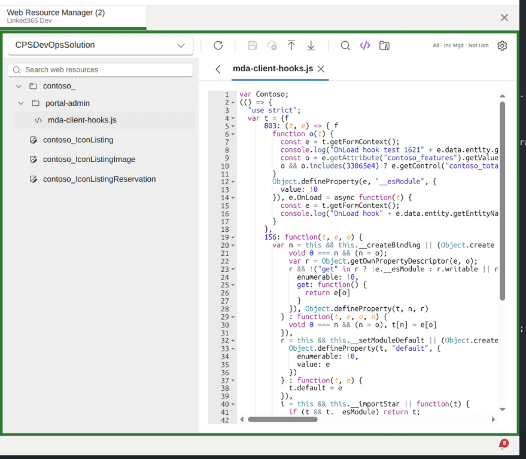

# Web Resource Manager

A [Power Platform ToolBox](https://powerplatformtoolbox.com) tool for browsing, editing, and publishing Dataverse web resources.

*Screenshot of the tool running inside PPTB. The capture shows a development environment and has been cleared for public sharing.*

## How to use

1. Install tool from Power Platfrom ToolBox market place
2. Launch tool and select an environment.
3. Select a solution to load and then open a web resource.
4. Different options are available depending on the type of resource avialble.

## Features

### Solution Browser

- Search and select from available unmanaged solutions by friendly or unique name
- Hierarchical tree view of web resources organised by folder path
- Resizable side panel (220–600px) with expand/collapse toggle
- Full-text search across resource names and paths (with 300ms debounce)

### Multi-Tab Editor

- Open multiple resources in tabs simultaneously
- Tab overflow menu when space is limited — active tab is always visible
- Closing a tab auto-switches to the nearest remaining tab
- Close button positioned on the right side of each tab

### Format-Specific Viewers

| Type  | Formats                         | Viewer        | Capabilities                                                                                                                                   |
| ----- | ------------------------------- | ------------- | ---------------------------------------------------------------------------------------------------------------------------------------------- |
| Code  | HTML, CSS, JavaScript, XML, XSL | Ace Editor    | Syntax highlighting, content search with match highlighting, line numbers, light/dark theme                                                     |
| Image | PNG, JPEG, GIF                  | Image preview | Zoom (25–400%), copy base64 to clipboard                                                                                                       |
| SVG   | SVG                             | Inline render | Zoom (25–800%), copy source to clipboard                                                                                                       |
| RESX  | RESX                            | Data grid     | Editable Name/Value columns, read-only Comment column (text selectable for copying), add rows, sortable, resizable & wrapping columns         |

### Resource Actions

- **Save** — save content to Dataverse without publishing
- **Save & Publish** — save and publish in a single action; if content is already saved, publish it
- **Upload** — replace resource content from a local file (validates file extension)
- **Download** — export resource to a local file with correct extension and MIME type
- **Prettify** — format HTML, CSS, or JavaScript 
- **Minify** — minify HTML or JavaScript 
- **Search** — find and highlight matches within code resource content
- **Edit Resources** - Modify resource files
- **Refresh** — reload the resource content from Dataverse, discarding any unsaved local changes

All editing actions are disabled for non-customizable (managed layer) resources.

Before a Dataverse write, the tool shows the target environment and affected resource or solution. Replacing resource content requires exporting a backup first. Restore is manual; publishing cannot be automatically undone. Folder renames attempt to roll back completed renames if a later resource fails.

### Context Menu (Tree View)

Right-click any item in the tree to access contextual actions:

- **New Resource** — create a new web resource under the selected folder
- **New Subfolder / New Root Folder** — add a virtual folder to organise resources
- **Rename** — rename a resource or folder (including bulk-rename of all resources within)
- **Refresh** — reload the selected resource's content from Dataverse

### Filtering

- **Resource types** — toggle individual types on/off (HTML, CSS, JS, XML, PNG, JPG, GIF, XSL, SVG, RESX)
- **Managed resources** — include or exclude managed resources
- **Hidden resources** — include or exclude hidden resources
- **Prefix exclusion** — comma-separated prefixes to exclude (default: `msdyn_`, `adx_`, `cc_MscrmControls`)
- Active filter summary displayed in the toolbar (e.g. _All · Not Mgd · Not Hdn_)
- Loading stops after 100 pages or if Dataverse repeats a paging cookie; refine filters to load a smaller result set.

## What this tool changes

- Creates web resources in Dataverse and adds them to the selected unmanaged solution.
- Replaces web resource content when **Save** or **Save & Publish** is confirmed.
- Publishes saved content when **Save & Publish** is confirmed.
- Renames individual web resources and bulk-renames resources under a folder.
- Exports files to the local computer and reads explicitly selected files for upload.
- Keeps virtual folders only in the current tool session; they do not change Dataverse.

The target environment name and URL are shown before confirmation, including for production environments. There is no automatic undo after a successful create, content save, or publish. Before replacing content, export the offered backup and retain it if you may need to restore the previous version. A failed create attempts to delete the new resource if adding it to the solution fails. A folder rename can be cancelled between Dataverse requests; completed renames are rolled back on cancellation or failure where possible, and incomplete rollback is reported.

## Credits

This tool is inspired by the [WebResourcesManager for XrmToolBox](https://github.com/MscrmTools/MsCrmTools.WebResourcesManager) by MsCRMTools. Only inspiration, no code, was used to create this version. The name is used with agreement with the author.

This tool has been built with the assistance of AI tools. Manual testing details are documented in [TESTING.md](./TESTING.md).

## Updates

### 2026-10-30

- Added environment-and-scope review before Dataverse writes, with a required backup export before replacing content.
- Hardened SVG previews, added fresh write-target checks, and added rollback attempts for failed folder renames.
- Added automated tests and implementation notes.
- Added a human acceptance-testing checklist for real PPTB and Dataverse verification.
- Confirmed the README screenshot is cleared for public sharing.
- Set the package baseline to 1.0.0 and added a reviewed, provenance-enabled Release Please publishing workflow.
- This release includes code and tests developed with AI assistance; maintainers remain responsible for reviewing and testing the tool.

See [implementation and test details](./IMPLEMENTATION.md).
Before marketplace submission, complete the [human acceptance-testing checklist](./TESTING.md).
Releases are created from reviewed Release Please pull requests; see [release process](./IMPLEMENTATION.md#releases).

## License

MIT
